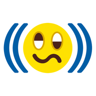
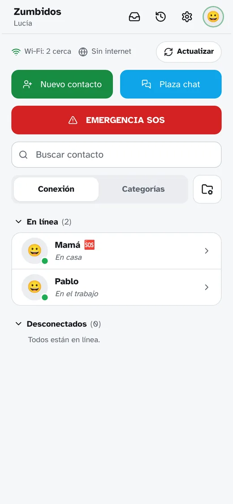
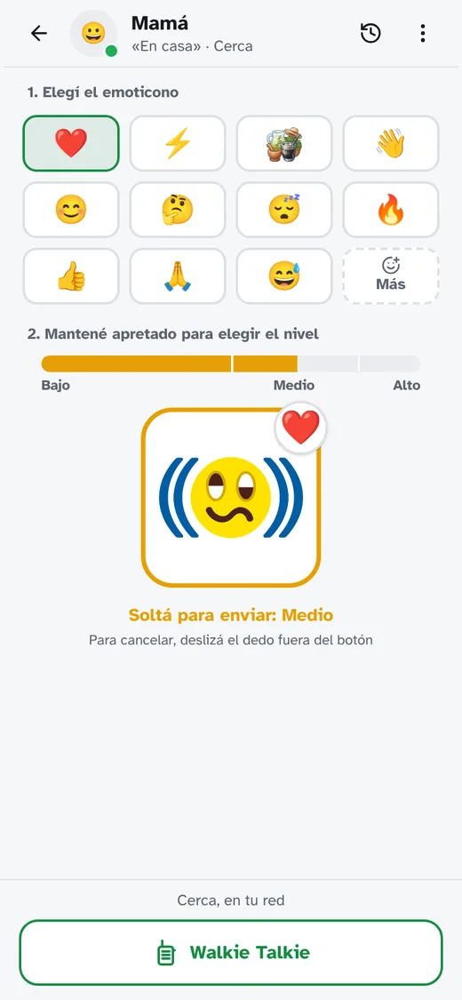
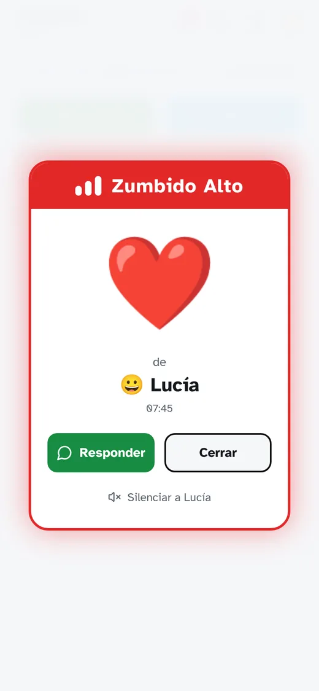
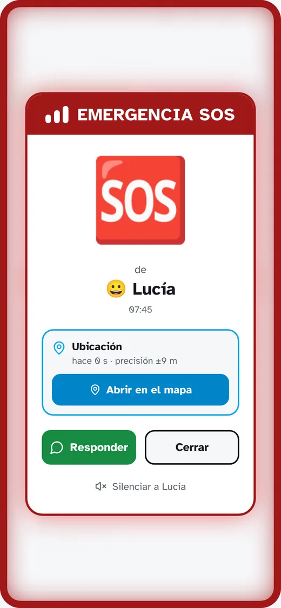

# Zumbidos

**Avisale a tu gente sin escribir una palabra.** Zumbidos es una app para Android que manda un emoticono y un nivel de urgencia a tus contactos cercanos, por Wi‑Fi o por internet. Gratis, sin cuenta y sin publicidad.

- 🌐 Sitio: https://euroluar.github.io/zumbidos-actualizaciones/
- ⬇️ Descarga directa (última versión): https://github.com/euroluar/zumbidos-actualizaciones/releases/download/ultima/zumbidos.apk
- 🔒 [Política de privacidad](privacidad.html)

## Qué hace

- **Zumbidos con nivel:** mantené apretado el botón; cuanto más tiempo, más urgente (bajo, medio, alto).
- **SOS:** sirena hasta que lo atiendan y ubicación compartida mientras dure, solo con contactos de emergencia que aceptaron.
- **Walkie talkie** en el momento, sin grabaciones.
- **Plaza chat** con quienes están cerca, con alias y sin guardar mensajes.
- **Funciona sin internet** entre teléfonos de la misma red Wi‑Fi; internet es opcional.
- **Cifrado de punta a punta**; tus datos se quedan en tu teléfono.

Zumbidos no reemplaza al 911 ni a los servicios de emergencia.

¿Sugerencias o problemas? Abrí un [issue](https://github.com/euroluar/zumbidos-actualizaciones/issues).
